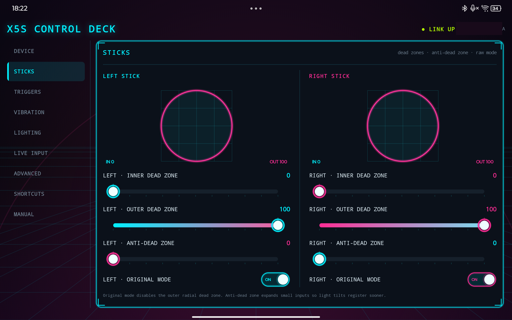

<p align="center">
  <a href="https://buymeacoffee.com/mavasilisk">
    
  </a>
</p>

<h1 align="center">X5S Control Deck</h1>

<p align="center"><strong>A free, standalone settings app for the GameSir X5s controller on Android.</strong></p>

<p align="center">X5S Control Deck is a standalone settings app for the GameSir X5s. It connects to the pad directly over Bluetooth LE and gives you every setting the hardware exposes — dead zones, stick mode, triggers, vibration, lighting and more. No account, no telemetry, no vendor app.</p>

<p align="center">
  <a href="X5S-Control-Deck-3.0-release.apk"></a>
  
</p>

<p align="center">
  
</p>

---

## Download

**`X5S-Control-Deck-3.0-release.apk`** (1.6 MB)

SHA-256: `fc1612a4cbd6311447d247643cd67da566dc08800ec48841e3d0dc8fa25d8995`

Check the file before installing:

```sh
sha256sum X5S-Control-Deck-3.0-release.apk
```

**Requirements:** Android 12 or later with Bluetooth LE, and a GameSir X5s controller. No root, no account.

---

## What this app does

- **Sticks** — inner and outer dead zones for both sticks, a per-stick anti-dead zone, and **Original (raw)** mode for full-range output.
- **D-pad** — diagonal lock and L-stick ↔ D-pad swap.
- **Triggers** — front and back dead zones for LT/RT and **Quickshot** (hair-trigger) mode.
- **Vibration** — left/right grip motor strength, on/off, and an LT+RT test that fires both motors.
- **Lighting** — Home/logo colour, brightness and effect presets.
- **Live input** — a real-time view of stick positions, trigger values, the D-pad and every button.
- **Shortcuts** — map VIEW + button combos to system actions (Home, Back, Recents, notifications, Quick Settings) that keep working while other apps are in front.
- **Manual** — an offline reference for the controller itself: modes, pairing, button combos and calibration.
- **Restore defaults** — put every setting back the way GameSir shipped it.
- **Advanced flags** — exposes protocol options the X5s profile hides.

Firmware flashing is intentionally **not** implemented: the X5s firmware is an encrypted vendor blob that cannot be modified.

## Screens

The left rail selects a screen; the right pane shows that screen's settings, laid out in two columns so everything fits without scrolling.

| Screen | Contents |
|---|---|
| **DEVICE** | Firmware, hardware, BLE and MAC, live battery, connect/disconnect, read config, restore defaults, and a TX/ACK line showing whether the controller acknowledged the last write. |
| **STICKS** | Left/right inner and outer dead zones with a live dead-zone visualiser and stick dot, anti-dead zone L/R, Original mode L/R. |
| **TRIGGERS** | LT/RT front and back dead zones, live press meters with dead-zone markers, Quickshot L/R. |
| **VIBRATION** | Left/right grip strength (read back from the pad) and a LT+RT motor test at the configured strengths. |
| **LIGHTING** | Home/logo RGB sliders with swatch and hex, presets (OFF / WHITE / CYAN / MAGENTA / LIME), static effect. |
| **LIVE INPUT** | Raw LX/LY/RX/RY, LT/RT, D-pad hat and a button log, with stick dots on the previews. |
| **ADVANCED** | Protocol flags the X5s profile hides: stick swap, inversions, D-pad diagonal lock, L-stick ↔ D-pad swap, LT↔LB / RT↔RB, low battery, play-while-charging, dock auto, auto sleep. |
| **SHORTCUTS** | Assign VIEW + button combos to Home, Back, Recents, notifications, Quick Settings and an in-app system-bar toggle; they work in other apps through an accessibility service. |
| **MANUAL** | Offline copy of the controller's manual notes — see below. |

## MANUAL page

The app ships the controller's manual notes so you don't need the web, a PDF or the vendor app while you're setting the pad up. It covers:

- **Basic operation** — power on/off, standby, low battery, charging, and how to check the current mode.
- **Connection status** — what a solid, rapidly flashing and slowly flashing indicator mean.
- **Platform and mode** — Android, DS4, Switch and G-Touch: indicator colour, the button hold that switches mode, and the Bluetooth name the pad advertises.
- **Connect** — pairing steps per platform, iOS notes and USB-C behaviour.
- **Button combos** (hold **M**, then press) — stick dead-zone toggle (M + L3 / R3), turbo per button, vibration (M + D-pad up/down), hair trigger (M + LT/RT), layout swap (M + A), volume (HOME + D-pad up/down).
- **Calibration** — sticks and triggers (L3 + R3 + VIEW + START, rotate, pull, save with B) and gyroscope (M + B on a flat surface).

**M** is the extra button beside HOME. These combos are handled by the controller itself and don't need the app.

## Install

1. Copy `X5S-Control-Deck-3.0-release.apk` to the tablet or phone and open it.
2. Allow **Nearby devices** when Android asks (the app needs Bluetooth scan/connect).
3. Close the GameSir app if it's running, open **X5S Control Deck** and tap **CONNECT**.

For the SHORTCUTS screen, enable **X5S Control Deck** under Settings → Accessibility.

## How it connects

The app talks to the X5s over its Bluetooth LE configuration channel. Every change is written to the controller, waits for the pad's acknowledgement and is read back from the controller, and the app re-reads the full config on every connect. Settings live on the controller, not in the app.

It has **no internet permission** — nothing is sent anywhere and there is no analytics.

## Troubleshooting

| Symptom | Fix |
|---|---|
| Stuck on `NOT FOUND` / `RETRY` | The GameSir app is usually still holding the BLE link. Close/force-stop it and tap **CONNECT**. |
| Connects but no data | The pad streams its config channel to one host at a time — close the GameSir app, if you have it installed. |
| A setting doesn't stick | Check the TX/ACK line on DEVICE. `NO ACK` means the write didn't land; reconnect and try again. |
| Shortcut combos do nothing in other apps | The accessibility service isn't enabled (Settings → Accessibility → X5S Control Deck). |
| Sliders move while scrolling | Drag sliders horizontally; vertical swipes scroll the screen. |

## Not included

- **Firmware updates** — the firmware is an encrypted vendor blob; the app never touches it.
- **Key mapping and macros** — those belong to GameSir's G-Touch mapping app, not the controller's own settings.
- **Other controllers** — the app targets the GameSir X5s only.
- The app cannot extend the stick range beyond 100 %: the outer dead zone is firmware/mechanical behaviour.

## Support

X5S Control Deck is free and always will be. If it saves you a trip through the GameSir app, you can say thanks with a coffee:

<p align="center">
  <a href="https://buymeacoffee.com/mavasilisk"></a>
</p>

## License

X5S Control Deck is **free to use, copy, modify, and share** for personal and other non-commercial purposes — no payment, account, or sign-up required.

The only conditions:

- **Credit the author.** If you share X5S Control Deck or a modified version, mention **Ivan Ivanov** and link back to [the project repository](https://github.com/Ivanov-k-Ivan/X5S-Control-Deck).
- **No commercial use.** You may not sell X5S Control Deck, bundle it into a paid product, or otherwise use it to make money.

See [LICENSE](https://github.com/Ivanov-k-Ivan/X5S-Control-Deck/blob/main/LICENSE) for the full terms.
